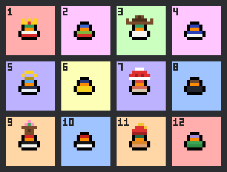
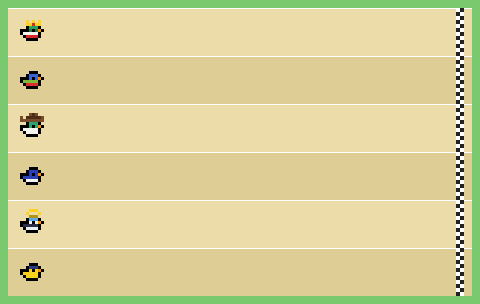

# DuckBot

A Discord bot for communities in which each member adopts up to three pixel-art ducks, dresses them with cosmetics,
trains them and enters them in animated races. Members earn an in-game currency, the **PatoCoin**, by chatting, by
checking in daily and by winning races.

The bot is available in **English and Spanish**; it replies in the language of each user's Discord client.

<p align="center">
  
  
</p>

## Features

- **Adoption.** Adopt a random duck or choose one from a catalog. Ducks whose owners have left the server may reappear
  as ownerless ducks that new members can adopt.
- **Gallery.** Browse every duck in the server in a numbered grid, and open the animated card of any of them.
- **Progression.** Messages earn XP towards a player level, and each new level awards PatoCoins. Every duck also has
  its own level, which is raised by spending PatoCoins.
- **Races.** Races of up to eight ducks are rendered as an animated GIF. When fewer members join, the remaining lanes
  are filled by bot-controlled ducks, so a member can race alone.
- **Shop and wardrobe.** Preview a cosmetic on your own duck before buying it, and recolor it afterwards.
- **Economy.** Daily check-in, transfers between members and a private balance.
- **Moderation tools.** XP events, shop prices, gifted cosmetics and coin adjustments, restricted by role.

Replies are private to the member who issued the command, except for races and level-up announcements.

## Commands

Every command is available in English and Spanish. Discord shows the Spanish names to users whose client is set to
Spanish. Arguments in square brackets are optional.

### Members

| English                 | Spanish                        | Description                                                                                                              |
| ----------------------- | ------------------------------ | ------------------------------------------------------------------------------------------------------------------------ |
| `/ping`                 | `/ping`                        | Checks that the bot is responding.                                                                                       |
| `/adopt name [catalog]` | `/adoptar nombre [catalogo]`   | Adopts a duck (up to three), either random or taken from the catalog.                                                    |
| `/duck [user] [duck]`   | `/pato [usuario] [pato]`       | Opens the gallery of all ducks. A duck's card links to its owner's other ducks and, for your own ducks, to the wardrobe. |
| `/rename name [duck]`   | `/renombrar nombre [pato]`     | Renames one of your ducks.                                                                                               |
| `/release duck`         | `/liberar pato`                | Releases one of your ducks after confirmation, refunding half of the PatoCoins spent on training it.                     |
| `/train [duck]`         | `/entrenar [pato]`             | Spends PatoCoins to raise a duck's level, which makes it faster in races.                                                |
| `/shop [duck]`          | `/tienda [pato]`               | Browses the cosmetics on sale, previews them on your duck, and lets you buy and equip them.                              |
| `/race [duck]`          | `/carrera [pato]`              | Opens a race. Members have 60 seconds to join, after which the race is played and prizes are awarded.                    |
| `/daily`                | `/diario`                      | Daily check-in that awards PatoCoins once per day.                                                                       |
| `/balance`              | `/saldo`                       | Shows your PatoCoins and your player level.                                                                              |
| `/pay user amount`      | `/transferir usuario cantidad` | Sends PatoCoins to another member, after confirmation.                                                                   |


### Members

| English                     | Spanish                        | Description                                                                                                              |
| ----------------------------| ------------------------------ | ------------------------------------------------------------------------------------------------------------------------ |
| `/ping`                     | `/ping`                        | Checks that the bot is responding.                                                                                       |
| `/adopt` `name` `[catalog]` |  `/adoptar` `name` `[catalog]` | Adopts a duck (up to three), either random or taken from the catalog.                                                    |
| `/duck` `[user]` `[duck]`   | `/pato` `[user]` `[duck]`      | Opens the gallery of all ducks. A duck's card links to its owner's other ducks and, for your own ducks, to the wardrobe. |
| `/rename` `name` `[duck]`   | `/renombrar` `name` `[duck]`   | Renames one of your ducks.                                                                                               |
| `/release` `duck`           | `/liberar` `duck`              | Releases one of your ducks after confirmation, refunding half of the PatoCoins spent on training it.                     |
| `/train` `[duck]`           | `/entrenar` `[duck]`           | Spends PatoCoins to raise a duck's level, which makes it faster in races.                                                |
| `/shop` `[duck]`            | `/tienda` `[duck]`             | Browses the cosmetics on sale, previews them on your duck, and lets you buy and equip them.                              |
| `/race` `[duck]`            | `/carrera` `[duck]`            | Opens a race. Members have 60 seconds to join, after which the race is played and prizes are awarded.                    |
| `/daily`                    | `/diario`                      | Daily check-in that awards PatoCoins once per day.                                                                       |
| `/balance`                  | `/saldo`                       | Shows your PatoCoins and your player level.                                                                              |
| `/pay` `user` `amount`      | `/transferir` `user` `amount`  | Sends PatoCoins to another member, after confirmation.                                                                   |

### Staff

By default these commands are visible only to members with the **Manage Server** permission. To grant them to a role,
open **Server Settings → Integrations → the bot**, select the command, choose **Add Roles or Members** and allow the
role. Each command is configured independently.

| English                                   | Spanish                                     | Description                                                                         |
| ----------------------------------------- | ------------------------------------------- | ----------------------------------------------------------------------------------- |
| `/event start multiplier hours [channel]` | `/evento crear multiplicador horas [canal]` | Starts an XP multiplier (×1.5, ×2 or ×3) in one channel or in the whole server.     |
| `/event end event`                        | `/evento terminar evento`                   | Ends an XP event early.                                                             |
| `/cosmetics price cosmetic [price]`       | `/cosmeticos precio cosmetico [precio]`     | Sets the price of a cosmetic; without a price, removes it from the shop.            |
| `/cosmetics give user cosmetic`           | `/cosmeticos dar usuario cosmetico`         | Gives a cosmetic to a member.                                                       |
| `/cosmetics take user cosmetic`           | `/cosmeticos quitar usuario cosmetico`      | Takes a cosmetic away from a member.                                                |
| `/cosmetics role cosmetic [role]`         | `/cosmeticos rol cosmetico [rol]`           | Grants a cosmetic to every member holding a role; without a role, removes the link. |
| `/coins give user amount`                 | `/monedas dar usuario cantidad`             | Adds PatoCoins to a member.                                                         |
| `/coins take user amount`                 | `/monedas quitar usuario cantidad`          | Removes PatoCoins from a member (a balance never falls below zero).                 |

## How it works

- **Ducks.** Each member may own up to three ducks. Only the owner can rename, train, dress or release a duck.
- **Player level.** Each message awards 10 XP, at most once per minute. Every new level awards `level × 10` PatoCoins
  and is announced in a dedicated channel.
- **Duck level.** Levels range from 1 to 20 and are raised only with `/train`, at a cost of `current level × 50`
  PatoCoins. A duck's level gives it up to a 10% speed advantage in races.
- **Races.** A server may hold up to ten races per day, one at a time. Eight ducks always compete. With a single
  player, the prizes are 50, 30 and 20 PatoCoins for the first three places and 10 for the rest; each additional player
  increases them by 25%. Bot-controlled ducks do not earn prizes.
- **Economy.** The daily check-in awards 25 PatoCoins and cosmetics cost 150 by default.
- **Ownerless ducks.** When a member leaves the server, their ducks lose their owner and return to level 1 while keeping
  their cosmetic. When adopting at random, there is a 25% chance of being offered one of them.
- **Adopter role.** Members who own at least one duck receive an adopter role, which the bot creates if necessary.

Every numeric value is defined in [`packages/core/src/rules.ts`](packages/core/src/rules.ts).

## Installation

### Requirements

- Node.js 22.12 or later
- pnpm 10 (`npm install -g pnpm@10`)

No external services are required: the database is a local SQLite file.

### 1. Create the Discord application

1. In the [Discord Developer Portal](https://discord.com/developers/applications), create a **New Application**.
2. Under **General Information**, copy the **Application ID** (`DISCORD_CLIENT_ID`).
3. Under **Bot**, reset and copy the token (`DISCORD_TOKEN`). It is displayed only once. Leave all **Privileged Gateway
   Intents** disabled.
4. Invite the bot with the following URL, replacing `YOUR_CLIENT_ID`:

   ```
   https://discord.com/oauth2/authorize?client_id=YOUR_CLIENT_ID&scope=bot+applications.commands&permissions=268487680
   ```

   The URL grants the permissions View Channels, Send Messages, Embed Links, Attach Files and Manage Roles.

5. In **Server Settings → Roles**, move the bot's role above the adopter role, since Discord does not allow a bot to
   assign roles that sit above its own.
6. Create a text channel named `duckbot` for level-up announcements.
7. Enable **Developer Mode** in your Discord settings, right-click the server and choose **Copy Server ID**
   (`DISCORD_DEV_GUILD_ID`).

The token is the bot's password. Store it only in `.env`, which is excluded from version control, and regenerate it in
the portal if it is ever exposed.

### 2. Configure and run

```bash
pnpm install
cp .env.example .env    # on Windows: copy .env.example .env
```

Fill in the three Discord values in `.env`. All other settings have defaults:

| Variable               | Purpose                                                                   | Default                  |
| ---------------------- | ------------------------------------------------------------------------- | ------------------------ |
| `DISCORD_TOKEN`        | Bot token                                                                 | —                        |
| `DISCORD_CLIENT_ID`    | Application ID                                                            | —                        |
| `DISCORD_DEV_GUILD_ID` | Server in which the commands are registered                               | —                        |
| `ASSETS_DIR`           | Folder with the cosmetics and the catalog (see [Art assets](#art-assets)) | `assets`                 |
| `DATABASE_URL`         | SQLite database file                                                      | `file:./data/duckbot.db` |
<<<<<<< HEAD
| `DEFAULT_LOCALE`       | Fallback language: `en-US` or `es-419`                                    | `en-US`                  |
| `TIMEZONE`             | IANA time zone; daily limits reset at midnight in this zone               | `UTC`                    |
| `LEVEL_UP_CHANNEL`     | Name of the channel for level-up announcements                            | `duckbot`                |
| `ADOPTER_ROLE`         | Name of the role given to duck owners                                     | `Duck Adopter`           |
=======
| `DEFAULT_LOCALE`       | Fallback language: `es-419` or `en-US`                                    | `es-419`                 |
| `TIMEZONE`             | IANA time zone; daily limits reset at midnight in this zone               | `America/Mexico_City`    |
| `LEVEL_UP_CHANNEL`     | Name of the channel for level-up announcements                            | `duckbot`                |
| `ADOPTER_ROLE`         | Name of the role given to duck owners                                     | `Adoptador de patos`     |
| `LOG_LEVEL`            | `debug`, `info`, `warn` or `error`                                        | `info`                   |

Then generate the database client, create the database, register the commands and start the bot:

```bash
pnpm db:generate
pnpm db:migrate
pnpm commands:deploy
pnpm dev
```

The bot responds only while the process is running. Run `pnpm commands:deploy` again whenever the commands change.

## Art assets

The artwork is not part of the code. The bot reads it from the folder given by `ASSETS_DIR`, which may be located
outside the repository:

```
<ASSETS_DIR>/
├── accessories.json      Cosmetics
└── catalog/
    └── *.duck.json       Catalog ducks
```

- **`accessories.json`** is a list of cosmetics. Each one has an `id`, a name in `en-US` and `es-419`, a main color, and
  four faces (right, front, left, back), each with two 16×16 layers (`under` is drawn behind the duck, `over` in
  front). The file is validated at startup; if it is missing or invalid, the bot starts without cosmetics and logs a
  warning.
- **`catalog/*.duck.json`** are projects exported from the duck-editor sprite editor; the 8×8 version of each duck is
  used. `pnpm catalog:birds` generates a larger catalog of ducks named after birds.

The repository includes a minimal sample: eight caps (one white and one for each color of the rainbow) in
[`assets/accessories.json`](assets/accessories.json), regenerated with `pnpm assets:sample`, and three ducks in
`assets/catalog/`. To use your own artwork, place it in another folder and set `ASSETS_DIR` accordingly.

## Development

| Command                     | Description                                     |
| --------------------------- | ----------------------------------------------- |
| `pnpm dev`                  | Starts the bot and restarts it on file changes. |
| `pnpm start`                | Starts the bot.                                 |
| `pnpm commands:deploy`      | Registers the slash commands.                   |
| `pnpm db:generate`          | Generates the Prisma client.                    |
| `pnpm db:migrate`           | Applies (and creates) database migrations.      |
| `pnpm db:studio`            | Opens Prisma Studio.                            |
| `pnpm test`                 | Runs the tests (Vitest).                        |
| `pnpm typecheck`            | Type-checks every package.                      |
| `pnpm lint` / `pnpm format` | Runs ESLint and Prettier.                       |

**Stack:** TypeScript on Node.js in a pnpm monorepo, discord.js 14, Prisma 7 with SQLite, Zod, and Vitest. Images are
generated in plain TypeScript, without native dependencies.

```
apps/bot/          Discord process: commands, buttons, message XP and scheduled tasks
packages/core/     Game rules (no Discord or database dependencies)
packages/render/   PNG and GIF rendering
packages/i18n/     English and Spanish messages
packages/db/       Prisma schema, migrations and SQLite client
assets/            Sample artwork and README images
scripts/           Asset generators
```

## Troubleshooting

| Symptom                           | Solution                                                                                 |
| --------------------------------- | ---------------------------------------------------------------------------------------- |
| `Invalid configuration in .env`   | A value is missing or malformed; the message names it.                                   |
| Cannot import `generated/prisma`  | Run `pnpm db:generate`.                                                                  |
| Commands do not appear            | Run `pnpm commands:deploy`, check `DISCORD_DEV_GUILD_ID`, and reload Discord.            |
| `Missing Access` when registering | The bot is not in that server, or was invited without the `applications.commands` scope. |
| `TokenInvalid` on startup         | The token is incorrect or has been regenerated.                                          |
| The adopter role is not assigned  | Grant the bot **Manage Roles** and place its role above the adopter role.                |
| "The application did not respond" | The bot process is not running.                                                          |

## License

Released under the MIT License.
